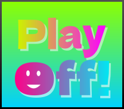

# Play Off！

気軽にゲームをPlay！
## 概要
Play Off！はブラウザで遊べるゲームを集めています。
ブラウザからすぐにアクセスでき、軽い動作を目指しています。  
## 特徴
* ホスティングのしやすさ:Renderなどでの静的サイトでのデプロイに対応。  
* カテゴリ別での表示:目的のジャンルごとでゲームを探せる。  
* 非営利運営:利益を目的とせず、誰もがゲームを楽しめる場所を目指しています。
# 更新履歴
## [v1.1.1] - 2026-10-16

### 追加
 - 新しいゲームの追加:Granny,Hole.ioなど
## [v1.1.0] - 2026-10-14

###  追加
- 新しいゲームを追加
- ゲーム:Slope 2 Player,Undertale,ブロックブラスト,ちいかわパズル,REPO,Slither.io,Snow.io,StickMan Hook,Snowride,Burnin' Rubber 5 XS,Mr.Racer

## [v1.0.0] - 2026-10-09

### 初回リリース
- Play Off！を公開
- ゲーム一覧ページを実装
- 基本的なゲームプレイ機能を実装

## フォーム
- 追加してほしいゲームや機能、評価を送れます。
[こちらから](https://forms.gle/kG2yhXak9CqULdQ39)
## やるべきこと
 - [ ] 人気,トピック,新着機能の追加
 - [ ] UIを独自性の高いものへ
 - [ ] セーブデータを保存できるように。
 - [ ] 左のサイドバーをCrazyGamesに近づけたい。
 - [ ] 1v1.lolなどの追加
 - [ ] Burnin' Rubber 5 XSをiframe埋め込み依存から脱却
 - [ ] 一部ゲームの不具合を直す

 ### 開発者
  - off_mix
  - E233-8000-NambuLine-MainLine
  - midmedusa

---

© 2026 Play Off! Contributors / Play Off！™  
本サイト独自の文章・ロゴなどの無断転載、
複製、再配布を禁止します。   
 - 【RECJ公認】登録番号:A0007
